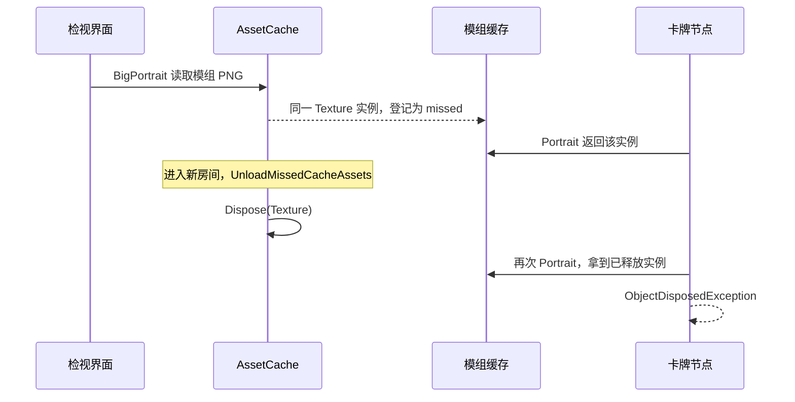

# 113 版本兼容性排查与 107/111/113 三版本适配结论

- 编号：003-R
- 日期：2026-11-14
- 排查对象：`ReaperReplacementMod`（死亡收割）v1.0
- 当前安装件：`mods/ReaperReplacementMod/`，DLL 构建于 2026-08-29
- 游戏版本：v0.107.1 / v0.111.0 / v0.113.0（113 的 `release_info`：commit `16ac0fe3`，2026-11-12）
- 关联文档：`4.SDD/001-总体设计.md`、`1.ADR/001-时候未到整卡替换为死亡收割.md`、`3.DOCS/001-T-110降至107切换导致存档损坏根因.md`、`2.PLANS/002-M-113适配与三版本回归.md`
- 状态：排查完成；未修改代码；未启动游戏

## 1. 结论

1. 卡牌行为不需要改。113 没有删除本 mod 依赖的成员，也没有删除 10 个 Harmony 补丁目标中的任何一个。
2. 113 需要修 1 处卡图生命周期问题。检视卡界面会把模组卡图交给 `PreloadManager.Cache`；进入下一个房间时该缓存释放纹理；模组仍返回同一个已释放对象。
3. 语言覆盖为 107 全部 14 种、111 缺 `ind`、113 缺 `ind` 与 `ara`。缺目录不会抛异常，只会回退英文。用户于 2026-11-14 决定不补。
4. 清单版本号 `1.0` 不是合法 SemVer。游戏只记录警告，不阻止加载。
5. 用 113 编译的单份 DLL，对 107/111/113 三份真实 `sts2.dll` 扫描，成员缺失 0，补丁目标缺失 0。「单 DLL + 单 pck 三版通用」成立。

## 2. 版本基线

| 版本 | 参考目录 | 反编译文件数 | 官方语言数 | 备注 |
|---|---|---|---|---|
| v0.107.1 | `STS2-Reference/1.STS2-107Reference` | 3425 | 14 | 无 `zht`、`ind`；参考目录中的这两个语言目录是解包残留 |
| v0.111.0 | `STS2-Reference/2.STS2-111Reference` | 3538 | 16 | 新增 `zht`、`ind` |
| v0.113.0 | `STS2-Reference/3.STS2-113Reference` | 3888 | 17 | 新增 `ara`；`ara` 为隐藏语言且从右到左排版 |

三份真实程序集位于 `STS2Mod-达弗修改/TMP/final-build-1.0.1/refs107|111|113/sts2.dll`。本文的二进制结论由这三份程序集得出。

## 3. 逐项兼容性核对

### 3.1 目标卡与补丁目标

`MegaCrit.Sts2.Core.Models.Cards.NotYet` 的源码在 107、111、113 三版逐字一致。补丁目标如下。

| 补丁目标 | 107 | 111 | 113 | 说明 |
|---|---|---|---|---|
| `CardModel.Type` getter | 存在 | 存在 | 存在 | `virtual` |
| `CardModel.TargetType` getter | 存在 | 存在 | 存在 | `virtual` |
| `NotYet.CanonicalVars` getter | 存在 | 存在 | 存在 | `protected override` |
| `NotYet.OnPlay` | 存在 | 存在 | 存在 | `(PlayerChoiceContext, CardPlay)` |
| `NotYet.OnUpgrade` | 存在 | 存在 | 存在 | 无参数 |
| `CardModel.PortraitPngPath` getter | 存在 | 存在 | 存在 | 107 为 `private`，111 起为 `protected virtual`；Harmony 按名补丁两边都能命中 |
| `CardModel.PortraitPath` getter | 存在 | 存在 | 存在 | `virtual` |
| `CardModel.Portrait` getter | 存在 | 存在 | 存在 | 非虚方法，补丁仍生效 |
| `CardModel.TitleLocString` getter | 存在 | 存在 | 存在 | 非虚方法 |
| `CardModel.Description` getter | 存在 | 存在 | 存在 | 非虚方法 |

验证方式：Mono.Cecil 读取真实 `sts2.dll`，按类型名、方法名和参数个数查找。三版均为 `missingTargets=0`。

### 3.2 运行时成员引用

现有 DLL（2026-08-29）与按 113 编译的临时 DLL，各自对三份 `sts2.dll` 扫描，结果为 `unresolvedRefs=0`。扫描对象是 DLL 内全部指向 `sts2` 的 `MemberReference`。

关键签名三版一致：

- `DamageCmd.Attack(decimal)`
- `AttackCommand.TargetingAllOpponents(ICombatState)`
- `AttackCommand.WithHitFx(string?, string?, string?)`
- `AttackCommand.Execute(PlayerChoiceContext?)`
- `AttackCommand.Results`
- `CreatureCmd.Heal(Creature, decimal, bool)`
- `DamageResult.UnblockedDamage`
- `DynamicVarSet.Damage`
- `DynamicVar.BaseValue`、`DynamicVar.UpgradeValueBy(decimal)`
- `LocString(string, string)`
- `Log.Info/Warn/Error(string, int)`

`AttackCommand.FromCard` 是唯一分版本的重载：

| 版本 | 重载 |
|---|---|
| 107 | `FromCard(CardModel)` |
| 111 | `FromCard(CardModel, CardPlay?)` |
| 113 | `FromCard(CardModel, CardPlay?)` |

现有代码用反射分派两态，运行到 107 用单参，运行到 111/113 用双参，不需要重新编译。

枚举数值也为编译期常量，三版一致：`CardType.Attack = 1`、`TargetType.AllEnemies = 3`、`ValueProp.Move = 8`。因此用 113 编译的 DLL 在 107 上不会因常量错位而改变行为。

### 3.3 Modding 与清单

`MegaCrit.Sts2.Core.Modding` 目录在 111 与 113 逐文件一致，包括 `ModManager`、`ModManifest`、`Mod`、`ModDependency`。清单字段没有新增必填项。

`min_game_version = 0.107.1` 在 113 下通过校验，mod 正常加载。

### 3.4 本地化

| 版本 | 官方语言数 | 模组覆盖 | 缺口 |
|---|---|---|---|
| 107 | 14 | 14 | 无 |
| 111 | 16 | 15 | `ind` |
| 113 | 17 | 15 | `ind`、`ara` |

模组 pck 内实际包含 15 个语言目录，已用 `strings` 核对安装件。

回退机制：加载非英语语言时，`LocManager` 先构建英文表；英文表在构建时已经合并模组的 `eng/cards.json`；目标语言缺失的键由 `LocTable` 回退到该英文表。因此缺失 `ind`、`ara` 时**不会抛 `LocException`**，卡名与描述显示英文。

`ara` 在 113 中还是隐藏语言和从右到左语言。隐藏语言需要通过特殊入口选择；即使如此，回退仍然成立，只是英文文本会按 RTL 方向排版。

> 更正：`STS2-Reference/v110-to-v111-compat.md` 称「缺失 mod 语言目录会抛 `LocException`」。该结论与 107/113 的 `LoadTablesFromPath` 实现不符。英文回退表包含模组键。

### 3.5 113 新增的卡图路径

113 的 `CardModel` 新增 `BigPortrait`。检视卡界面新增对该属性的调用。这是本次唯一需要适配的行为变化，详见第 4 节。

## 4. 发现：113 检视卡会释放模组卡图

### 4.1 触发链路



### 4.2 代码证据

- `3.STS2-113Reference/decompiled/MegaCrit.Sts2.Core.Models/CardModel.cs:185`：`BigPortrait` 通过 `PreloadManager.Cache.GetTexture2D(PortraitPngPath)` 取图。
- `3.STS2-113Reference/decompiled/MegaCrit.Sts2.Core.Nodes.Screens/NInspectCardScreen.cs:395`：113 新增 `_card.SetPortraitTexture(cardModel2.BigPortrait)`。
- `3.STS2-113Reference/decompiled/MegaCrit.Sts2.Core.Assets/AssetCache.cs:62`：未预载资源加入 `_missedCacheAssets`。
- `3.STS2-113Reference/decompiled/MegaCrit.Sts2.Core.Assets/AssetCache.cs:98`：`UnloadMissedCacheAssets()` 释放这些资源。
- `3.STS2-113Reference/decompiled/MegaCrit.Sts2.Core.Assets/AssetCache.cs:117`：`DisposeAtEndOfFrame()` 在帧末调用 `Dispose()`。
- `3.STS2-113Reference/decompiled/MegaCrit.Sts2.Core.Assets/PreloadManager.cs:156`：`LoadRoomAssets()` 在进入房间时调用 `UnloadMissedCacheAssets()`。
- `3.STS2-113Reference/decompiled/MegaCrit.Sts2.Core.Nodes.Cards/NCard.cs:884`：`UpdateVisuals()` 第一步调用 `UpdatePortrait()`。
- `3.STS2-113Reference/decompiled/MegaCrit.Sts2.Core.Nodes.Cards/NCard.cs:1259`：`UpdatePortrait()` 读取 `Model.Portrait`。
- `9.SRC/ReaperReplacementMod/PortraitTextureLoader.cs:19`：命中后永久返回静态 `_texture`。
- `9.SRC/ReaperReplacementMod/Patches/NotYetPortraitPatches.cs:36`：`Portrait` 补丁返回该缓存。
- `data_sts2_windows_x86_64/GodotSharp.dll` 的 `GodotObject.GetPtr`：对已释放对象执行 `ObjectDisposedException.ThrowIf`。

### 4.3 影响

1. 检视过「死亡收割」后，进入下一个房间或回主菜单，纹理被释放。
2. 再次显示该卡时，`TextureRect.Texture` 赋值抛 `ObjectDisposedException`。
3. `UpdateVisuals()` 在 `UpdatePortrait()` 处中断，后续标题、描述、费用更新不执行。
4. 107 与 111 没有 `BigPortrait`，模组纹理不进入 `AssetCache`，不触发。
5. 上述表现为静态推断；实机未验证。

### 4.4 修复方案

两个方案都可行，建议同时采用。

方案 A：加载前检查缓存有效性。

```csharp
if (_texture != null && GodotObject.IsInstanceValid(_texture))
    return _texture;

_texture = ResourceLoader.Load<Texture2D>(ModEntry.PortraitPng);
if (_texture != null) return _texture;

// 仍失败时走内嵌 PNG 兜底
```

`GodotObject.IsInstanceValid` 只读取 `NativeInstance`，对已释放对象返回 `false`，不会抛异常。

方案 B：加载时使用 `ResourceLoader.CacheMode.Ignore`，让模组纹理不进入游戏的 `AssetCache`。

两种方案的取舍：

| 方案 | 优点 | 代价 |
|---|---|---|
| A | 改动最小；任何一方释放后都能自愈 | 每次检视可能触发一次重新加载 |
| B | 从源头避免共享，不依赖游戏缓存 | 检视卡打开期间多一份纹理实例 |

## 5. 发现：语言覆盖缺口

现状与回退行为见 3.4。用户于 2026-11-14 决定**不补** `ind` 与 `ara`。

保留结论，供后续需求变化时使用：

- `ind` 的 STS1 官方文本为 `Dewa Kematian`，描述可按现有转换规则处理。
- `ara` 没有 STS1 来源，需要新写。113 官方术语可参考 `الحاصد`、`ألحق {Damage:diff()} ضررًا لجميع الأعداء`、`استعد ... صحة`、`الضرر غير المحجوب`。
- 新增语言文件时必须同步 `9.SRC/ReaperReplacementMod/export_presets.cfg` 的 `export_files`，否则不会进入 pck。

## 6. 发现：清单版本号不是 SemVer

游戏日志原文：

```text
[WARN] Mod ReaperReplacementMod declares version 1.0 which is not a valid Semantic Version
```

- 来源：`9.SRC/ReaperReplacementMod/ReaperReplacementMod.json` 的 `version` 字段。
- 影响：仅警告。`Mod.version` 保持为空，Steam 与本地重复时按「未知版本」处理，仍会禁用 Steam 副本。
- 修复：改为合法 SemVer，例如 `1.0.1` 或 `1.1.0`。

## 7. 不需要改的部分

113 的其他变更已逐项核对，对本 mod 无影响：

| 113 变更 | 本 mod 是否使用 | 结论 |
|---|---|---|
| `CreatureCmd.Damage` 改用 `DamageTargetData` | 否，mod 走 `AttackCommand` | 无影响 |
| `CardModel` 增加关键词来源跟踪（`_keywordsAddedFromOutside`） | 否，mod 不增删关键词 | 无影响 |
| `UpgradeInternal` 增加 `_isUpgrading` | 间接经过，但 mod 的 `OnUpgrade` Prefix 不新增关键词 | 无影响 |
| `DynamicVar` 的 `IConvertible` 行为改为返回 `PreviewValue` | 否，mod 使用 `{Damage:diff()}` 与 `BaseValue` | 无影响 |
| `CardType.Quest`、`ValueProp.FromArrow`、Blitz 模式 | 否 | 无影响 |
| `CardCmd.Exhaust` 返回类型变化 | 否 | 无影响 |
| VFX 重构、联机握手重构 | 否 | 无影响 |
| `DynamicVarSet` 新增 `HitCount`、`CalculatedHitCount` | 否 | 无影响 |

`CardModel` 新增 `BigPortrait` 是唯一需要处理的变化，见第 4 节。

## 8. 验证状态

### 8.1 已验证（静态）

1. 三份真实 `sts2.dll` 上，10 个补丁目标全部存在，`missingTargets=0`。
2. 现有 DLL 与 113 编译的临时 DLL，在 107/111/113 上 `unresolvedRefs=0`。
3. `NotYet.cs` 三版逐字一致；`MegaCrit.Sts2.Core.Modding` 目录 111 与 113 逐文件一致。
4. 语言数量、回退逻辑、`BigPortrait` 链路均按源码核对。

### 8.2 已验证（日志）

`%APPDATA%/SlayTheSpire2/logs/godot2026-11-14T20.15.02.log:539-543` 显示：

```text
[INFO] Loading assembly DLL ...\mods\ReaperReplacementMod\ReaperReplacementMod.dll
[INFO] Loading Godot PCK ...\mods\ReaperReplacementMod\ReaperReplacementMod.pck
[INFO] ReaperReplacementMod: loading...
[INFO] ReaperReplacementMod: Harmony patches applied (NotYet -> Reaper)
[INFO] Finished mod initialization for '死亡收割 (Reaper)' (ReaperReplacementMod).
```

同一日志 `:538` 有 SemVer 警告。

### 8.3 未验证（实机）

1. 113 下打出该卡的伤害、吸血、升级、消耗。
2. 第 4 节 `ObjectDisposedException` 的实际表现。
3. 107/111 的实机行为。
4. `ind`、`ara` 的回退显示效果。

原因：按要求未启动游戏。

### 8.4 未确认

1. 107 的 pck 与 Godot 运行环境。确认方法：在 107 安装并启动。
2. `ara` 回退文本在 RTL 布局下的可读性。确认方法：113 切换到 `ara` 后查看该卡。

## 9. 下次游戏更新后的复查清单

1. 比对目标卡源码（`NotYet.cs` 或替换目标）是否仍一致。
2. 用 Mono.Cecil 检查 10 个补丁目标是否存在，参数个数是否变化。
3. 扫描 mod DLL 的 `sts2` 成员引用，确认 0 缺失。
4. 比对 `MegaCrit.Sts2.Core.Modding` 目录。
5. 检查 `PortraitPngPath`、`PortraitPath`、`Portrait` 是否被新的渲染路径消费。113 的教训是：游戏可能新增一条读取卡图路径的链路，并把纹理交给自己的缓存。
6. 对照官方语言列表与模组语言目录。
7. 用 107/111/最新版三份 `sts2.dll` 重跑扫描。
8. 实机回归：打出、升级、检视后切房间、图鉴、语言切换。

### 9.1 扫描方法

现有工具 `STS2-兼容性诊断/TMP/01-诊断工具/ApiScan` 可以扫描 DLL 的成员引用，但搜索目录固定。若要按版本扫描，复制该项目并把 `SearchDirs()` 的第一项改为目标 `refs` 目录，然后执行：

```powershell
dotnet run -c Release -- "<mod.dll>"
```

预期输出：`TOTAL=0 UNIQUE=0`。

补丁目标检查可以用同一套 Mono.Cecil 逻辑，按「类型全名 + 方法名 + 参数个数」查找。预期 `missingTargets=0`。

## 10. 证据索引

### 10.1 本仓库

- `9.SRC/ReaperReplacementMod/PortraitTextureLoader.cs`
- `9.SRC/ReaperReplacementMod/Patches/NotYetPortraitPatches.cs`
- `9.SRC/ReaperReplacementMod/Patches/NotYetCorePatches.cs`
- `9.SRC/ReaperReplacementMod/Patches/NotYetOnPlayPatch.cs`
- `9.SRC/ReaperReplacementMod/Patches/NotYetTextPatches.cs`
- `9.SRC/ReaperReplacementMod/ReaperReplacementMod.json`
- `9.SRC/ReaperReplacementMod/export_presets.cfg`

### 10.2 游戏源码与程序集

- `STS2-Reference/1.STS2-107Reference/decompiled/`
- `STS2-Reference/2.STS2-111Reference/decompiled/`
- `STS2-Reference/3.STS2-113Reference/decompiled/`
- `STS2Mod-达弗修改/TMP/final-build-1.0.1/refs107|111|113/sts2.dll`
- `C:/Game/Steam/steamapps/common/Slay the Spire 2/data_sts2_windows_x86_64/GodotSharp.dll`

### 10.3 日志

- `%APPDATA%/SlayTheSpire2/logs/godot2026-11-14T20.15.02.log`

### 10.4 过程文件

- `%TEMP%/ApiScanVer`：按版本定向的 Mono.Cecil 扫描器副本，921 KB。
- `%TEMP%/ReaperBuild113`：按 113 编译的临时源码与产物，1.9 MB。
